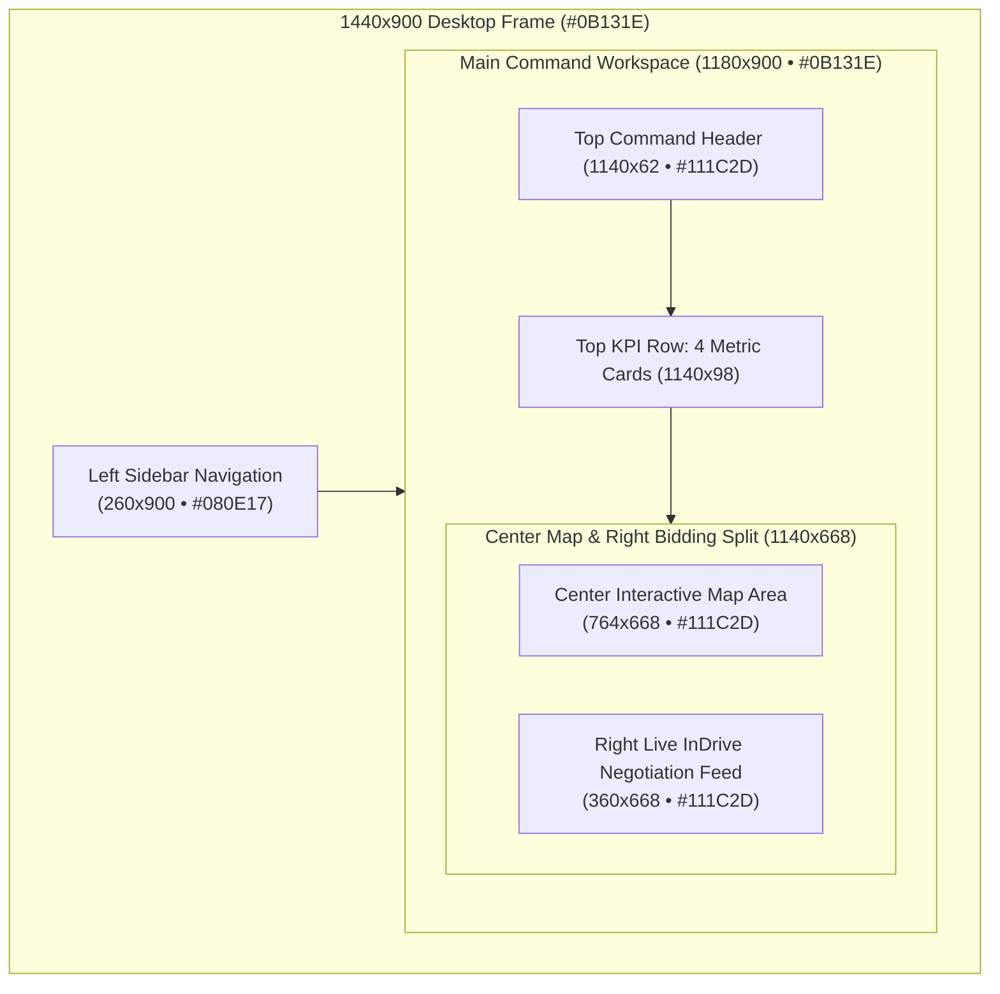

# CholoBhairab — Admin & Dispatch Command Center: Figma Design System

> **Document Title:** CholoBhairab — Admin & Dispatch Command Center Design System & Layout Specification  
> **Target Region:** Bhairab Upazila, Kishoreganj District, Bangladesh (`24.0487° N, 90.9852° E`)  
> **Figma Team Plan Key:** `team::1701210129182912999` (`Mehedi Hasan's team`)  
> **Figma Design File Name:** `CholoBhairab — Admin & Dispatch Command Center`  
> **Figma File Key:** `JgztYNhQXk5PyeKDMG5lp5`  
> **Figma Live Design URL:** [https://www.figma.com/design/JgztYNhQXk5PyeKDMG5lp5](https://www.figma.com/design/JgztYNhQXk5PyeKDMG5lp5)  
> **Figma Canvas Automation Script:** [`docs/figma-canvas-builder.js`](./figma-canvas-builder.js)

---

## 1. Executive Summary & Design Philosophy

**CholoBhairab (চলো ভৈরব)** is a hyper-local, multi-modal ride-sharing and dispatch platform built specifically for **Bhairab, Bangladesh** — bridging the Meghna River transit corridor, Bhairab Railway Junction, Kachari Bus Stand, and Old River Ghat.

The **Admin & Dispatch Command Center** uses a **high-contrast dark command center visual language** tailored for 24/7 dispatchers, fleet verifiers, and emergency responders:

1. **Glanceable Real-Time Telemetry:** High-luminance semantic status badges on a deep command slate (`#0B131E`) canvas reduce dispatcher eye strain while highlighting critical events (999 SOS alerts, low-wallet lockouts `< 50 BDT`, and active InDrive counter-bids).
2. **Bilingual Typographic Clarity (Bangla + English):** Combines clean geometric Latin numerals and headers (`Plus Jakarta Sans` / `Inter`) with legible Bangla script (`Hind Siliguri`) for voice-broadcast transcripts (`"নতুন ট্রিপ রিকোয়েস্ট..."`) and municipal KYC certificates (`ওয়ার্ড কাউন্সিলর প্রত্যয়নপত্র`).
3. **Hyper-Local Multi-Modal Identity:** Distinct color-coded badges distinguish Bhairab's 4 core vehicle tiers:
   - **Easy-Bike (`ইজিবাইক / অটো`)** — Emerald (`#10B981`)
   - **CNG Auto-Rickshaw (`সিএনজি`)** — Bid Amber (`#F59E0B`)
   - **Motorbike (`বাইক`)** — Electric Blue (`#3B82F6`)
   - **Noah / Hiace Microbus (`মাইক্রোবাস`)** — Royal Violet (`#8B5CF6`)

---

## 2. Brand Color Tokens (`CholoBhairab — Brand Color Tokens` Frame)

All colors are defined in Hex, CSS Custom Properties, and Figma Plugin API `0..1` normalized RGB float objects (`{ r, g, b }`).

| Token Name | Hex | Figma RGB (`0..1`) | CSS Variable | Semantic Usage Role |
| :--- | :--- | :--- | :--- | :--- |
| **Bangladesh Emerald** | `#006A4E` | `{ r: 0.000, g: 0.416, b: 0.306 }` | `--cb-emerald-primary` | Primary Brand Identity, Active Radar Header, Primary CTAs, Confirmed Trips |
| **Deep Command Slate** | `#0B131E` | `{ r: 0.043, g: 0.075, b: 0.118 }` | `--cb-bg-canvas` | Main 1440×900 Desktop Canvas Background, Nested Card Wells |
| **Elevated Card** | `#111C2D` | `{ r: 0.067, g: 0.110, b: 0.176 }` | `--cb-bg-surface` | KPI Metric Cards, Map Panel Container, Right InDrive Negotiation Feed |
| **bKash Magenta** | `#E2136E` | `{ r: 0.886, g: 0.075, b: 0.431 }` | `--cb-bkash-magenta` | Driver Prepaid Wallet Top-Up CTAs, 8% Commission Ledger Accents |
| **Bid Amber** | `#F59E0B` | `{ r: 0.961, g: 0.620, b: 0.043 }` | `--cb-bid-amber` | InDrive Fare Negotiation Highlights, Counter-Bid Cards, CNG Fleet Markers |
| **SOS Crimson** | `#F42A41` | `{ r: 0.957, g: 0.165, b: 0.255 }` | `--cb-sos-crimson` | Bangladesh Flag Red / 999 Emergency SOS Alerts, `< 50 BDT` Wallet Lockout |

### Supporting UI & Vehicle Tier Tokens

| Token Name | Hex | Figma RGB (`0..1`) | Role |
| :--- | :--- | :--- | :--- |
| **Sidebar Obsidian** | `#080E17` | `{ r: 0.031, g: 0.055, b: 0.090 }` | Left Navigation Sidebar Fill (`260×900`) |
| **Radar Map Abyss** | `#071019` | `{ r: 0.027, g: 0.063, b: 0.098 }` | Center Interactive Map Canvas Fill (`732×580`) |
| **Meghna Waterway** | `#0C243C` | `{ r: 0.047, g: 0.141, b: 0.235 }` | Stylized Meghna River Corridor Band |
| **Border Slate** | `#1E293B` | `{ r: 0.118, g: 0.161, b: 0.231 }` | `1px` Structural Card & Panel Hairline Borders |
| **Easy-Bike Mint** | `#10B981` | `{ r: 0.063, g: 0.725, b: 0.506 }` | Easy-Bike Badge, Online Socket Pulse, Passenger Offer Price |
| **Bike Cobalt** | `#3B82F6` | `{ r: 0.231, g: 0.510, b: 0.965 }` | Motorbike Fleet Marker & Intercity Corridor Badge |
| **Microbus Violet** | `#8B5CF6` | `{ r: 0.545, g: 0.361, b: 0.965 }` | Noah / Hiace Dhaka-Sylhet Highway Microbus Badge |

---

## 3. Typography & Bilingual Hierarchy

| Role | Font Family | Style / Weight | Size | Line Height | Color |
| :--- | :--- | :--- | :--- | :--- | :--- |
| **Dashboard Title** | `Inter` / `Plus Jakarta Sans` | `Bold (700)` | `18px` | `24px` | `#F8FAFC` |
| **KPI Metric Value** | `Inter` / `JetBrains Mono` | `Bold (700)` | `24px` | `30px` | `#F8FAFC` |
| **Section Heading** | `Inter` / `Plus Jakarta Sans` | `Bold (700)` | `15px–16px` | `22px` | `#F8FAFC` |
| **Card Title / Landmark** | `Inter` / `Hind Siliguri` | `Bold (700)` | `13px` | `18px` | `#F8FAFC` |
| **Body / Bid Details** | `Inter` / `Hind Siliguri` | `Regular / Semi Bold` | `11px–12px` | `16px` | `#94A3B8` |
| **Status Pill / Overline** | `Inter` / `JetBrains Mono` | `Bold (700)` | `10px–11px` | `14px` | Semantic Accent |

---

## 4. Main 1440×900 Desktop Dashboard Frame Architecture

**Frame Name:** `CholoBhairab Live Dispatch & InDrive Bidding Center`  
**Dimensions:** `1440px × 900px` (`HORIZONTAL` Auto-Layout root container, `itemSpacing: 0`, `fills: #0B131E`)

### 4.1 Left Sidebar Navigation (`260px × 900px`)
- **Container Specs:** Vertical Auto-Layout (`padding: 24px 20px`, `itemSpacing: 20px`, fill `#080E17`, right stroke `#1E293B`).
- **Brand Identity Header:** Bangladesh Emerald (`#006A4E` at `22%` opacity) card with `CB` monogram badge (`#006A4E`), title `"CholoBhairab"`, and subtitle `"Bhairab Dispatch Ops"`.
- **5 Navigation Modules:**
  1. **Live Dispatch Radar** *(Active State — `#006A4E` 28% fill, `#10B981` stroke)* — `6 Online • 1 Active Bid`
  2. **Driver KYC Verification** — `Ward Councilor & BRTA` (Tiered verification for Easy-Bikes/CNGs vs. Bikes/Microbuses)
  3. **bKash Wallet & 8% Commission Ledger** — `Min 50 BDT Threshold` (Automatic lockout below 50 BDT)
  4. **Bhairab Landmarks** — `6 Pre-Indexed Hubs` (Voice/Icon point-to-point fare matrix)
  5. **999 SOS Center** — `Emergency Telemetry` (National 999 emergency dispatch & WhatsApp live trip tracker)
- **Sidebar Footer Demo Card:** Dedicated simulation card with a 1-click **`⚡ Simulate Live Ride`** trigger button (`#006A4E` fill, `#10B981` border).

### 4.2 Top KPI Row (`1140px` Full Width, 4 Equal `FILL` Cards)
- **Container Specs:** Horizontal Auto-Layout (`itemSpacing: 16px`). Each card uses `#111C2D` surface fill, `#1E293B` `1px` border, `12px` corner radius, and `14px 16px` padding:
  1. **Online Fleet:** `6 Vehicles` (`2 Easy-Bike • 2 CNG • 1 Bike • 1 Micro`) — Badge: `100% GPS LOCK` (`#10B981`)
  2. **Active Bidding Trips:** `2 Live Rides` (`Avg Counter-Bid Response: 4.2s`) — Badge: `INDRIVE MODE` (`#F59E0B`)
  3. **Today's 8% Commission Revenue:** `1,420 BDT` (`Gross GMV: 17,750 BDT • bKash Prepaid`) — Badge: `+18.4% TODAY` (`#E2136E`)
  4. **Pending KYC Queue & Lockouts:** `1 Low Wallet / 2 KYC` (`Anwar Mia: 35 BDT < 50 BDT Min`) — Badge: `ACTION REQ` (`#F42A41`)

### 4.3 Center Interactive Map Area (`764px × 668px`)
- **Map Header & Multi-Modal Filter Pills:**
  - Title: `"Bhairab Multi-Modal Live Radar Map"`
  - Vehicle Filter Badges:
    * `Easy-Bike (2)` (`#10B981`)
    * `CNG (2)` (`#F59E0B`)
    * `Bike (1)` (`#3B82F6`)
    * `Microbus (1)` (`#8B5CF6`)
- **Interactive Radar Map Canvas (`732px × 580px`, `#071019`):**
  - Stylized **Meghna River Corridor** waterway (`#0C243C`) along the eastern boundary.
  - Active amber route vector connecting **Bhairab Railway Junction** (`24.0487°N, 90.9852°E`) to **Syed Nazrul Islam Meghna Bridge** (`24.0418°N, 91.0022°E`).
  - **Landmark & Fleet Telemetry Pins:**
    1. **Bhairab Railway Junction** (`24.0487°N, 90.9852°E`) — `PICKUP HUB • 80 BDT OFFER` • Driver: *Rafiqul Islam • Easy-Bike (193 BDT)* (`#10B981`)
    2. **Syed Nazrul Islam Meghna Bridge** (`24.0418°N, 91.0022°E`) — `DROPOFF • COUNTER 90 BDT` • Driver: *Kamal Hossain • CNG (340 BDT)* (`#F59E0B`)
    3. **Kachari Bus Stand** (`24.0535°N, 90.9811°E`) — `INTERCITY CORRIDOR` • Driver: *Zahid Hasan • Bike (125 BDT)* (`#3B82F6`)
    4. **Old River Ghat (Launch Terminal)** (`24.0425°N, 90.9840°E`) — `RIVER GHAT HUB` • Driver: *Sohel Rana • Microbus (850 BDT)* (`#8B5CF6`)
    5. **Chandiber General Hospital** (`24.0620°N, 90.9785°E`) — `LOW WALLET < 50 BDT` • Driver: *Anwar Mia • Easy-Bike (35 BDT LOCKED)* (`#F42A41`)

### 4.4 Right Live InDrive Fare Negotiation Feed (`360px × 668px`)
- **Container Specs:** Vertical Auto-Layout (`padding: 16px`, `itemSpacing: 12px`, fill `#111C2D`, stroke `#1E293B`, radius `14px`).
- **Passenger Initial Offer Card (`80 BDT`):**
  - Header Badge: `PASSENGER INITIAL OFFER • TRIP #CB-904` (`#10B981`)
  - Route: `Bhairab Railway Junction → Meghna Bridge`
  - Voice Broadcast Transcript: `"New trip from Railway Junction to Meghna Bridge, offer 80 Taka"` (`"নতুন ট্রিপ রিকোয়েস্ট: ভৈরব রেলওয়ে জংশন থেকে মেঘনা ব্রিজ। যাত্রীর প্রস্তাবিত ভাড়া ৮০ টাকা।"`)
  - Highlighted Offer Price: **`Passenger Offer: 80 BDT`** (`#10B981`) with `Easy-Bike / CNG` badge.
- **Driver Counter-Bid Cards:**
  - **Counter-Bid #1 (`90 BDT`):** *Md. Rafiqul Islam (Easy-Bike)* • `★ 4.9 Rating` • **`Counter-Offer: 90 BDT • ETA 2 mins (350m away)`** (`#F59E0B` border & `#FDE68A` price text) • `8% Platform Commission: 7.20 BDT (Wallet: 193 BDT)`
  - **Counter-Bid #2 (`95 BDT`):** *Kamal Hossain (CNG Auto)* • `★ 4.8 Rating` • **`Counter-Offer: 95 BDT • ETA 3 mins (600m away)`** • `8% Platform Commission: 7.60 BDT (Wallet: 340 BDT)`
- **1-Click Simulate Live Ride Trigger CTA:**
  - Full-width bKash Magenta (`#E2136E`) action button: **`⚡ Simulate Live Ride (80 BDT → 90 BDT)`** wired to `POST /admin/simulate/ride` in the web application.

---

## 5. Mapping Between Figma Canvas & React Admin Web Application (`apps/admin_web`)

| Figma Layer / Section | React View / Component (`apps/admin_web/src/App.tsx`) | Backend REST / Socket.IO Endpoint |
| :--- | :--- | :--- |
| `Left Sidebar Navigation` | Sidebar Navigation (`activeTab` state switcher) | `GET /admin/overview` badge counters |
| `Top KPI Row` | 4-Card KPI Telemetry Ribbon | `GET /admin/overview` + `admin:telemetry` |
| `Center Interactive Map Area` | `LiveRadar` Leaflet Map (`[24.0487, 90.9852]`) | `GET /geo/landmarks`, `driver:location:changed` |
| `Right Live InDrive Fare Negotiation Feed` | Real-Time Bidding & Bangla Voice Feed | `ride:requested`, `ride:bid:Placed`, `ride:accepted` |
| `CTA / 1-Click Simulate Live Ride` | `Simulate Live Ride` Header & Feed Button | `POST /admin/simulate/ride` |
| `Nav / Driver KYC Verification` | `KycCenter` Tiered Document Verification View | `GET /admin/kyc`, `POST /admin/kyc/:id/status` |
| `Nav / bKash Wallet & 8% Ledger` | `WalletLedger` Prepaid Wallet & Top-Up View | `GET /admin/wallets`, `POST /admin/wallet/topup` |
| `Nav / 999 SOS Center` | `SafetyConsole` 999 Emergency SOS Console | `POST /admin/rides/:id/sos`, `ride:sos:triggered` |
