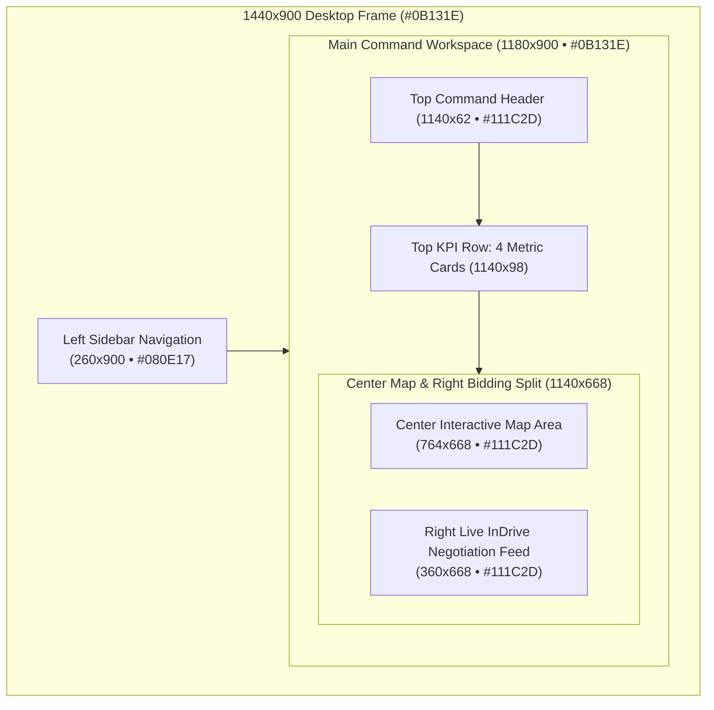
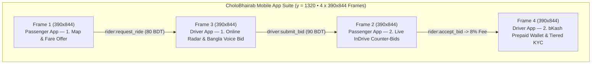
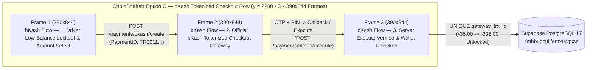

# CholoBhairab — Admin & Dispatch Command Center: Figma Design System

> **Document Title:** CholoBhairab — Admin & Dispatch Command Center Design System & Layout Specification  
> **Target Region:** Bhairab Upazila, Kishoreganj District, Bangladesh (`24.0487° N, 90.9852° E`)  
> **Figma Team Plan Key:** `team::1701210129182912999` (`Mehedi Hasan's team`)  
> **Figma Design File Name:** `CholoBhairab — Admin & Dispatch Command Center`  
> **Figma File Key:** `JgztYNhQXk5PyeKDMG5lp5`  
> **Figma Live Design URL:** [https://www.figma.com/design/JgztYNhQXk5PyeKDMG5lp5](https://www.figma.com/design/JgztYNhQXk5PyeKDMG5lp5)  
> **Figma Desktop Canvas Script:** [`docs/figma-canvas-builder.js`](./figma-canvas-builder.js)  
> **Figma Mobile App Suite Script:** [`docs/figma-mobile-builder.js`](./figma-mobile-builder.js)  
> **Figma Option C bKash Flow Script:** [`docs/figma-bkash-flow-builder.js`](./figma-bkash-flow-builder.js)  
> **Supabase PostgreSQL 17 Project:** `fmhbugcullfemxtevpxw` (`ap-southeast-1` • RLS Enabled)

---

## 1. Executive Summary & Design Philosophy

**CholoBhairab (চলো ভৈরব)** is a hyper-local, multi-modal ride-sharing and dispatch platform built specifically for **Bhairab, Bangladesh** — bridging the Meghna River transit corridor, Bhairab Railway Junction, Kachari Bus Stand, and Old River Ghat.

The **Admin & Dispatch Command Center** uses a **high-contrast dark command center visual language** tailored for 24/7 dispatchers, fleet verifiers, and emergency responders:

1. **Glanceable Real-Time Telemetry:** High-luminance semantic status badges on a deep command slate (`#0B131E`) canvas reduce dispatcher eye strain while highlighting critical events (999 SOS alerts, low-wallet lockouts `< 50 BDT`, and active InDrive counter-bids).
2. **Bilingual Typographic Clarity (Bangla + English):** Combines clean geometric Latin numerals and headers (`Plus Jakarta Sans` / `Inter`) with legible Bangla script (`Hind Siliguri`) for voice-broadcast transcripts (`"নতুন ট্রিপ রিকোয়েস্ট..."`) and municipal KYC certificates (`ওয়ার্ড কাউন্সিলর প্রত্যয়নপত্র`).
3. **Hyper-Local Multi-Modal Identity:** Distinct color-coded badges distinguish Bhairab's 4 core vehicle tiers:
   - **Easy-Bike (`ইজিবাইক / অটো`)** — Emerald (`#10B981`)
   - **CNG Auto-Rickshaw (`সিএনজি`)** — Bid Amber (`#F59E0B`)
   - **Motorbike (`বাইক`)** — Electric Blue (`#3B82F6`)
   - **Noah / Hiace Microbus (`মাইক্রোবাস`)** — Royal Violet (`#8B5CF6`)

---

## 2. Brand Color Tokens (`CholoBhairab — Brand Color Tokens` Frame)

All colors are defined in Hex, CSS Custom Properties, and Figma Plugin API `0..1` normalized RGB float objects (`{ r, g, b }`).

| Token Name | Hex | Figma RGB (`0..1`) | CSS Variable | Semantic Usage Role |
| :--- | :--- | :--- | :--- | :--- |
| **Bangladesh Emerald** | `#006A4E` | `{ r: 0.000, g: 0.416, b: 0.306 }` | `--cb-emerald-primary` | Primary Brand Identity, Active Radar Header, Primary CTAs, Confirmed Trips |
| **Deep Command Slate** | `#0B131E` | `{ r: 0.043, g: 0.075, b: 0.118 }` | `--cb-bg-canvas` | Main 1440×900 Desktop Canvas Background, Nested Card Wells |
| **Elevated Card** | `#111C2D` | `{ r: 0.067, g: 0.110, b: 0.176 }` | `--cb-bg-surface` | KPI Metric Cards, Map Panel Container, Right InDrive Negotiation Feed |
| **bKash Magenta** | `#E2136E` | `{ r: 0.886, g: 0.075, b: 0.431 }` | `--cb-bkash-magenta` | Driver Prepaid Wallet Top-Up CTAs, 8% Commission Ledger Accents |
| **Bid Amber** | `#F59E0B` | `{ r: 0.961, g: 0.620, b: 0.043 }` | `--cb-bid-amber` | InDrive Fare Negotiation Highlights, Counter-Bid Cards, CNG Fleet Markers |
| **SOS Crimson** | `#F42A41` | `{ r: 0.957, g: 0.165, b: 0.255 }` | `--cb-sos-crimson` | Bangladesh Flag Red / 999 Emergency SOS Alerts, `< 50 BDT` Wallet Lockout |

### Supporting UI & Vehicle Tier Tokens

| Token Name | Hex | Figma RGB (`0..1`) | Role |
| :--- | :--- | :--- | :--- |
| **Sidebar Obsidian** | `#080E17` | `{ r: 0.031, g: 0.055, b: 0.090 }` | Left Navigation Sidebar Fill (`260×900`) |
| **Radar Map Abyss** | `#071019` | `{ r: 0.027, g: 0.063, b: 0.098 }` | Center Interactive Map Canvas Fill (`732×580`) |
| **Meghna Waterway** | `#0C243C` | `{ r: 0.047, g: 0.141, b: 0.235 }` | Stylized Meghna River Corridor Band |
| **Border Slate** | `#1E293B` | `{ r: 0.118, g: 0.161, b: 0.231 }` | `1px` Structural Card & Panel Hairline Borders |
| **Easy-Bike Mint** | `#10B981` | `{ r: 0.063, g: 0.725, b: 0.506 }` | Easy-Bike Badge, Online Socket Pulse, Passenger Offer Price |
| **Bike Cobalt** | `#3B82F6` | `{ r: 0.231, g: 0.510, b: 0.965 }` | Motorbike Fleet Marker & Intercity Corridor Badge |
| **Microbus Violet** | `#8B5CF6` | `{ r: 0.545, g: 0.361, b: 0.965 }` | Noah / Hiace Dhaka-Sylhet Highway Microbus Badge |

---

## 3. Typography & Bilingual Hierarchy

| Role | Font Family | Style / Weight | Size | Line Height | Color |
| :--- | :--- | :--- | :--- | :--- | :--- |
| **Dashboard Title** | `Inter` / `Plus Jakarta Sans` | `Bold (700)` | `18px` | `24px` | `#F8FAFC` |
| **KPI Metric Value** | `Inter` / `JetBrains Mono` | `Bold (700)` | `24px` | `30px` | `#F8FAFC` |
| **Section Heading** | `Inter` / `Plus Jakarta Sans` | `Bold (700)` | `15px–16px` | `22px` | `#F8FAFC` |
| **Card Title / Landmark** | `Inter` / `Hind Siliguri` | `Bold (700)` | `13px` | `18px` | `#F8FAFC` |
| **Body / Bid Details** | `Inter` / `Hind Siliguri` | `Regular / Semi Bold` | `11px–12px` | `16px` | `#94A3B8` |
| **Status Pill / Overline** | `Inter` / `JetBrains Mono` | `Bold (700)` | `10px–11px` | `14px` | Semantic Accent |

---

## 4. Main 1440×900 Desktop Dashboard Frame Architecture

**Frame Name:** `CholoBhairab Live Dispatch & InDrive Bidding Center`  
**Dimensions:** `1440px × 900px` (`HORIZONTAL` Auto-Layout root container, `itemSpacing: 0`, `fills: #0B131E`)

### 4.1 Left Sidebar Navigation (`260px × 900px`)
- **Container Specs:** Vertical Auto-Layout (`padding: 24px 20px`, `itemSpacing: 20px`, fill `#080E17`, right stroke `#1E293B`).
- **Brand Identity Header:** Bangladesh Emerald (`#006A4E` at `22%` opacity) card with `CB` monogram badge (`#006A4E`), title `"CholoBhairab"`, and subtitle `"Bhairab Dispatch Ops"`.
- **5 Navigation Modules:**
  1. **Live Dispatch Radar** *(Active State — `#006A4E` 28% fill, `#10B981` stroke)* — `6 Online • 1 Active Bid`
  2. **Driver KYC Verification** — `Ward Councilor & BRTA` (Tiered verification for Easy-Bikes/CNGs vs. Bikes/Microbuses)
  3. **bKash Wallet & 8% Commission Ledger** — `Min 50 BDT Threshold` (Automatic lockout below 50 BDT)
  4. **Bhairab Landmarks** — `6 Pre-Indexed Hubs` (Voice/Icon point-to-point fare matrix)
  5. **999 SOS Center** — `Emergency Telemetry` (National 999 emergency dispatch & WhatsApp live trip tracker)
- **Sidebar Footer Demo Card:** Dedicated simulation card with a 1-click **`⚡ Simulate Live Ride`** trigger button (`#006A4E` fill, `#10B981` border).

### 4.2 Top KPI Row (`1140px` Full Width, 4 Equal `FILL` Cards)
- **Container Specs:** Horizontal Auto-Layout (`itemSpacing: 16px`). Each card uses `#111C2D` surface fill, `#1E293B` `1px` border, `12px` corner radius, and `14px 16px` padding:
  1. **Online Fleet:** `6 Vehicles` (`2 Easy-Bike • 2 CNG • 1 Bike • 1 Micro`) — Badge: `100% GPS LOCK` (`#10B981`)
  2. **Active Bidding Trips:** `2 Live Rides` (`Avg Counter-Bid Response: 4.2s`) — Badge: `INDRIVE MODE` (`#F59E0B`)
  3. **Today's 8% Commission Revenue:** `1,420 BDT` (`Gross GMV: 17,750 BDT • bKash Prepaid`) — Badge: `+18.4% TODAY` (`#E2136E`)
  4. **Pending KYC Queue & Lockouts:** `1 Low Wallet / 2 KYC` (`Anwar Mia: 35 BDT < 50 BDT Min`) — Badge: `ACTION REQ` (`#F42A41`)

### 4.3 Center Interactive Map Area (`764px × 668px`)
- **Map Header & Multi-Modal Filter Pills:**
  - Title: `"Bhairab Multi-Modal Live Radar Map"`
  - Vehicle Filter Badges:
    * `Easy-Bike (2)` (`#10B981`)
    * `CNG (2)` (`#F59E0B`)
    * `Bike (1)` (`#3B82F6`)
    * `Microbus (1)` (`#8B5CF6`)
- **Interactive Radar Map Canvas (`732px × 580px`, `#071019`):**
  - Stylized **Meghna River Corridor** waterway (`#0C243C`) along the eastern boundary.
  - Active amber route vector connecting **Bhairab Railway Junction** (`24.0487°N, 90.9852°E`) to **Syed Nazrul Islam Meghna Bridge** (`24.0418°N, 91.0022°E`).
  - **Landmark & Fleet Telemetry Pins:**
    1. **Bhairab Railway Junction** (`24.0487°N, 90.9852°E`) — `PICKUP HUB • 80 BDT OFFER` • Driver: *Rafiqul Islam • Easy-Bike (193 BDT)* (`#10B981`)
    2. **Syed Nazrul Islam Meghna Bridge** (`24.0418°N, 91.0022°E`) — `DROPOFF • COUNTER 90 BDT` • Driver: *Kamal Hossain • CNG (340 BDT)* (`#F59E0B`)
    3. **Kachari Bus Stand** (`24.0535°N, 90.9811°E`) — `INTERCITY CORRIDOR` • Driver: *Zahid Hasan • Bike (125 BDT)* (`#3B82F6`)
    4. **Old River Ghat (Launch Terminal)** (`24.0425°N, 90.9840°E`) — `RIVER GHAT HUB` • Driver: *Sohel Rana • Microbus (850 BDT)* (`#8B5CF6`)
    5. **Chandiber General Hospital** (`24.0620°N, 90.9785°E`) — `LOW WALLET < 50 BDT` • Driver: *Anwar Mia • Easy-Bike (35 BDT LOCKED)* (`#F42A41`)

### 4.4 Right Live InDrive Fare Negotiation Feed (`360px × 668px`)
- **Container Specs:** Vertical Auto-Layout (`padding: 16px`, `itemSpacing: 12px`, fill `#111C2D`, stroke `#1E293B`, radius `14px`).
- **Passenger Initial Offer Card (`80 BDT`):**
  - Header Badge: `PASSENGER INITIAL OFFER • TRIP #CB-904` (`#10B981`)
  - Route: `Bhairab Railway Junction → Meghna Bridge`
  - Voice Broadcast Transcript: `"New trip from Railway Junction to Meghna Bridge, offer 80 Taka"` (`"নতুন ট্রিপ রিকোয়েস্ট: ভৈরব রেলওয়ে জংশন থেকে মেঘনা ব্রিজ। যাত্রীর প্রস্তাবিত ভাড়া ৮০ টাকা।"`)
  - Highlighted Offer Price: **`Passenger Offer: 80 BDT`** (`#10B981`) with `Easy-Bike / CNG` badge.
- **Driver Counter-Bid Cards:**
  - **Counter-Bid #1 (`90 BDT`):** *Md. Rafiqul Islam (Easy-Bike)* • `★ 4.9 Rating` • **`Counter-Offer: 90 BDT • ETA 2 mins (350m away)`** (`#F59E0B` border & `#FDE68A` price text) • `8% Platform Commission: 7.20 BDT (Wallet: 193 BDT)`
  - **Counter-Bid #2 (`95 BDT`):** *Kamal Hossain (CNG Auto)* • `★ 4.8 Rating` • **`Counter-Offer: 95 BDT • ETA 3 mins (600m away)`** • `8% Platform Commission: 7.60 BDT (Wallet: 340 BDT)`
- **1-Click Simulate Live Ride Trigger CTA:**
  - Full-width bKash Magenta (`#E2136E`) action button: **`⚡ Simulate Live Ride (80 BDT → 90 BDT)`** wired to `POST /admin/simulate/ride` in the web application.

---

## 5. Mapping Between Figma Canvas & React Admin Web Application (`apps/admin_web`)

| Figma Layer / Section | React View / Component (`apps/admin_web/src/App.tsx`) | Backend REST / Socket.IO Endpoint |
| :--- | :--- | :--- |
| `Left Sidebar Navigation` | Sidebar Navigation (`activeTab` state switcher) | `GET /admin/overview` badge counters |
| `Top KPI Row` | 4-Card KPI Telemetry Ribbon | `GET /admin/overview` + `admin:telemetry` |
| `Center Interactive Map Area` | `LiveRadar` Leaflet Map (`[24.0487, 90.9852]`) | `GET /geo/landmarks`, `driver:location:changed` |
| `Right Live InDrive Fare Negotiation Feed` | Real-Time Bidding & Bangla Voice Feed | `ride:requested`, `ride:bid:Placed`, `ride:accepted` |
| `CTA / 1-Click Simulate Live Ride` | `Simulate Live Ride` Header & Feed Button | `POST /admin/simulate/ride` |
| `Nav / Driver KYC Verification` | `KycCenter` Tiered Document Verification View | `GET /admin/kyc`, `POST /admin/kyc/:id/status` |
| `Nav / bKash Wallet & 8% Ledger` | `WalletLedger` Prepaid Wallet & Top-Up View | `GET /admin/wallets`, `POST /admin/wallet/topup` |
| `Nav / 999 SOS Center` | `SafetyConsole` 999 Emergency SOS Console | `POST /admin/rides/:id/sos`, `ride:sos:triggered` |

---

## 6. Mobile App Suite Architecture (`4 × 390×844` Frames at `y = 1320`)

Built via [`docs/figma-mobile-builder.js`](./figma-mobile-builder.js), a horizontal row of four `390px × 844px` mobile device frames (`28px` corner radius, `#0B131E` canvas fill, `40px` horizontal frame gap) sits cleanly at `y = 1320` directly beneath the `1440×900` Desktop Dispatch Command Center frame.

### 6.1 Frame 1 (`390×844`): `"Passenger App — 1. Map & Fare Offer"`
- **Top Status Bar & Brand Header:**
  - Status bar (`9:41`, `5G • GPS • 100%`)
  - Brand Title: `চলো ভৈরব • যাত্রী` (`CholoBhairab Passenger • Bhairab`)
  - Emergency Action Pill: `🚨 999 SOS` (`#F42A41` SOS Crimson)
- **Stylized Bhairab Map Viewport (`358×196`, `#071019`):**
  - Displays GPS coordinates badge (`24.0487°N, 90.9852°E • 1.89 km`) and stylized Meghna River corridor (`#0C243C`).
  - Pickup Hub Pin (`#10B981`): `ভৈরব বাজার রেলওয়ে জংশন` (`Bhairab Railway Junction`)
  - Dropoff Hub Pin (`#F59E0B`): `সৈয়দ নজরুল ইসলাম সেতু / মেঘনা ব্রিজ` (`1.89 km`)
- **4 Multi-Modal Vehicle Selector Cards (`2×2` Auto-Layout Grid):**
  1. `ইজিবাইক ৳50` (`Easy-Bike • 1–4 Seats` — Active Emerald selection `#006A4E` / `#10B981`)
  2. `বাইক ৳70` (`Motorbike • Fast 1 Seat` — `#3B82F6`)
  3. `সিএনজি ৳90` (`CNG Auto • 1–3 Seats` — `#F59E0B`)
  4. `ঢাকা মাইক্রোবাস ৳300` (`Microbus • Highway` — `#8B5CF6`)
- **InDrive Fare Negotiation Stepper & Primary CTA:**
  - Interactive Stepper Row: `-৳5` pill, center **`৳80 প্রস্তাবিত ভাড়া`** (`Proposed Offer • Cash Only`), and `+৳5` pill (`#F59E0B`).
  - Full-width Bangladesh Emerald CTA (`#006A4E`): **`⚡ রাইড রিকোয়েস্ট পাঠান • Request Ride`**.

### 6.2 Frame 2 (`390×844`): `"Passenger App — 2. Live InDrive Counter-Bids"`
- **Live Bidding Header:**
  - Overline Badge: `REAL-TIME INDRIVE NEGOTIATION` (`#F59E0B`)
  - Headline: `লাইভ ড্রাইভার বিডিং • 2 Drivers Bidding`
  - Active Route Subtitle: `আপনার প্রস্তাব: ৳80 • ভৈরব রেলওয়ে জংশন → মেঘনা ব্রিজ`
- **Incoming Counter-Bid Card 1 (`৳90` — `#10B981` Border):**
  - Driver & Vehicle Info: `মোঃ রফিকুল ইসলাম • ভৈরব ইজিবাইক #১২ • ★ 4.9 • ২ মিনিট দূরে • ৳90`
  - Verification Subtext: `Md. Rafiqul Islam • 350m away • পৌরসভা ওয়ার্ড কাউন্সিলর যাচাইকৃত`
  - Action CTA: **`✓ গ্রহণ করুন (Accept ৳90)`** (`#006A4E` Emerald fill)
- **Incoming Counter-Bid Card 2 (`৳95` — `#F59E0B` Border):**
  - Driver & Vehicle Info: `কামাল হোসেন • সিএনজি অটো #০৮ • ★ 4.8 • ৩ মিনিট দূরে • ৳95`
  - Verification Subtext: `Kamal Hossain • 600m away • পৌরসভা ওয়ার্ড কাউন্সিলর যাচাইকৃত`
  - Action CTA: **`✓ গ্রহণ করুন (Accept ৳95)`** (`#006A4E` Emerald fill)
- **Bottom Safety & Family Tracking Bar:**
  - WhatsApp Live Tracking Button (`#006A4E` / `#10B981`): **`🔗 WhatsApp লাইভ ট্র্যাকিং শেয়ার`**
  - National Emergency SOS Button (`#F42A41`): **`🚨 জরুরী ৯৯৯ SOS`**

### 6.3 Frame 3 (`390×844`): `"Driver App — 1. Online Radar & Bangla Voice Bid"`
- **Driver Status Header:**
  - Brand Title: `চলো ভৈরব • চালক` (`CholoBhairab Driver`)
  - Prepaid Wallet Pill: **`৳193`** (`#E2136E` bKash Magenta)
  - Online Status Toggle Bar: **`🟢 আপনি অনলাইন আছেন`** (`ইজিবাইক #১২`)
- **Bhairab Hotspot Radar Card (`#071019`):**
  - Badge: `LIVE BHAIRAB HOTSPOT RADAR` (`#10B981`)
  - Demand Zone: `ভৈরব রেলওয়ে স্টেশন জোন • High Demand` (`24.0487°N, 90.9852°E • 4 Active Ride Requests within 1.5 km`)
- **Incoming Ride Opportunity Modal (`#111C2D` with `2px` `#F59E0B` Amber Border):**
  - **Bangla Voice Alert Banner (`#0B131E`):**
    * `🔊 "নতুন ট্রিপ রিকোয়েস্ট: ভৈরব বাজার রেলওয়ে জংশন থেকে মেঘনা ব্রিজ, প্রস্তাবিত ভাড়া ৮০ টাকা"`
  - **Primary Emerald Accept Button (`#006A4E`):**
    * **`✓ ৮০ টাকায় গ্রহণ করুন (Accept 80 BDT)`**
  - **Quick Counter-Bid Pills Row (`#F59E0B`):**
    * **`+১০ (৳90)`** | **`+২০ (৳100)`** | **`+৩০ (৳110)`**

### 6.4 Frame 4 (`390×844`): `"Driver App — 2. bKash Prepaid Wallet & Tiered KYC"`
- **Prepaid Wallet Card (`#111C2D` with `#10B981` Border):**
  - Main Balance: **`বর্তমান ব্যালেন্স: ৳ 193.00`**
  - Minimum Threshold Rule: `নূন্যতম ৫০ টাকা ব্যালেন্স বজায় রাখুন (Min 50 BDT Threshold)`
  - Commission Badge: `8% স্বয়ংক্রিয় কমিশন` (`#006A4E`)
- **bKash (`#E2136E`) & Nagad (`#F7941D`) Instant Recharge Section:**
  - Provider Selector Pills: `● bKash (#E2136E)` and `○ Nagad নগদ (#F7941D)`
  - Quick Recharge Amount Pills: **`+৳100`**, **`+৳200`**, **`+৳500`**
  - Primary bKash CTA (`#E2136E`): **`৳ বিকাশ রিচার্জ করুন`**
- **Tiered Municipal KYC Status Card (`#006A4E` Border):**
  - Headline: **`✓ অনুমোদিত চালক • ভৈরব পৌরসভা ওয়ার্ড কাউন্সিলর প্রত্যয়নপত্র ও NID যাচাইকৃত`**
  - Subtext: `Easy-Bike / CNG Tier • Ward 04 Councilor Certificate + Smart NID Verified`
- **Recent Wallet Ledger Rows (`#0B131E` Cards):**
  1. **`-৳7.00 ট্রিপ কমিশন (৮%)`** (`#F59E0B`) — `Trip #CB-904 (Fare ৳90) • Auto-Deducted`
  2. **`+৳200.00 বিকাশ রিচার্জ`** (`#10B981`) — `bKash Webhook TrxID: BKH98241M • Instant Credit`

---

## 7. Cross-Platform Mapping: Mobile Figma Frames ↔ Codebase (`apps/passenger_app`, `apps/driver_app`, `apps/mobile_simulator`)

| Figma Mobile Frame & Component | Flutter Passenger App (`apps/passenger_app`) | Flutter Driver App (`apps/driver_app`) | Dual-Phone Web Simulator (`apps/mobile_simulator`) | Backend Socket.IO / REST Contract |
| :--- | :--- | :--- | :--- | :--- |
| **Frame 1:** `Passenger App — 1. Map & Fare Offer` | `lib/screens/home_map_screen.dart` (Landmark picker, 4 vehicle cards, `-৳5/+৳5` stepper) | — | Left Phone (`PassengerPhone` — Map & Fare Offer tab) | `GET /geo/landmarks`, `GET /geo/fares/estimate`, `rider:request_ride` |
| **Frame 2:** `Passenger App — 2. Live InDrive Counter-Bids` | `lib/screens/bidding_sheet.dart` & `lib/screens/active_ride_screen.dart` (Counter-bid cards, WhatsApp share, 999 SOS) | — | Left Phone (`PassengerPhone` — Live Counter-Bids & Safety bar) | `ride:new_bid`, `rider:accept_bid`, `ride:driver_assigned`, `POST /admin/rides/:id/sos` |
| **Frame 3:** `Driver App — 1. Online Radar & Bangla Voice Bid` | — | `lib/screens/driver_radar_screen.dart` & `lib/services/bangla_voice_service.dart` (Online toggle, TTS prompt, `+১০/+২০/+৩০` pills) | Right Phone (`DriverPhone` — Radar, Web Speech Bangla TTS & Quick Bid pills) | `driver:go_online`, `driver:ride_opportunity`, `driver:submit_bid`, `driver:complete_ride` |
| **Frame 4:** `Driver App — 2. bKash Prepaid Wallet & Tiered KYC` | — | `lib/screens/wallet_screen.dart` & `lib/screens/kyc_screen.dart` (`৳193` balance, `<50 BDT` lockout, bKash/Nagad top-up, Ward Councilor KYC) | Right Phone (`DriverPhone` — bKash Wallet & Tiered KYC tabs) | `GET /wallet/balance/:id`, `POST /wallet/topup/bkash`, `POST /auth/driver/kyc` |

---

## 8. Option C: Supabase PostgreSQL 17 Schema & 3-Screen bKash Tokenized Checkout Flow (`y = 2280`)

Built via [`docs/figma-bkash-flow-builder.js`](./figma-bkash-flow-builder.js), a third horizontal row at `y = 2280` (with its Section Header Banner at `y = 2200`, directly below the 4 Mobile App Suite frames at `y = 1320`) visualizes the **Option C Production Persistence & Payment Security Architecture** combining **Supabase PostgreSQL 17.6 (`fmhbugcullfemxtevpxw`)** and the **bKash Tokenized Checkout API (`v1.2.0-beta`)**.

### 8.1 Section Header Banner (`y = 2200`, `1250×64`)
- **Banner Name:** `CHOLOBHAIRAB OPTION C — SUPABASE POSTGRES 17 + bKASH TOKENIZED CHECKOUT v1.2.0-beta`
- **Architecture Subtitle:** `Supabase Project: fmhbugcullfemxtevpxw (PostgreSQL 17.6 • RLS Locked) • Tokenized Flow: grant → create → callback → execute • UNIQUE gateway_trx_id`
- **Status Pills:**
  1. `🗄️ SUPABASE POSTGRES 17` (`#10B981` Emerald)
  2. `💳 bKASH v1.2.0-beta` (`#E2136E` bKash Magenta)
  3. `🔒 REPLAY SAFE` (`#F59E0B` Bid Amber)

### 8.2 Frame 1 (`390×844` at `y = 2280`): `"bKash Flow — 1. Driver Low-Balance Lockout & Amount Select"`
- **Crimson Low-Balance Lockout Alert Card (`#F42A41` Border & `14%` Tint):**
  - Target Driver: **Anwar Mia (`driver_demo_4` • Easy-Bike `#04` • Chandiber General Hospital Hub)**
  - Threshold Violation: **`৳35.00 < ৳50.00 Minimum Threshold`**
  - Bangla Lockout Alert: **`🔒 কম ব্যালেন্স! বিড করতে নূন্যতম ৫০ টাকা প্রয়োজন`**
  - Enforcement Rule: Blocks `driver:submit_bid` until the driver's prepaid balance is restored to `>= 50.00 BDT`.
- **bKash Tokenized Recharge & Amount Selector Card (`#111C2D` with `#E2136E` Border):**
  - Minimum Top-Up Guard Badge: `MIN TOP-UP: ৳20` (`BadRequestException` if `amountBdt < 20`).
  - Preset Selector Pills:
    * `+৳100` (`New: ৳135`)
    * **`+৳200 Selected`** (`New: ৳235` — `#E2136E` active selection)
    * `+৳500` (`New: ৳535`)
  - Post-Topup Projection Strip: **`৳35.00 + ৳200.00 → ৳235.00`** (`🟢 Unlocks Bidding`).
  - Primary Action CTA (`#E2136E`): **`⚡ Create Tokenized Payment (POST /payments/bkash/create)`**.

### 8.3 Frame 2 (`390×844` at `y = 2280`): `"bKash Flow — 2. Official bKash Tokenized Checkout Gateway"`
- **Official bKash Magenta Gateway Header (`#E2136E`):**
  - Title: `bKash Tokenized Checkout` (`v1.2.0-beta` badge)
  - Endpoint Context: `বিকাশ পেমেন্ট গেটওয়ে • tokenized.sandbox.bka.sh` (or built-in `/payments/bkash/mock/checkout?paymentID=...`)
- **Merchant & Invoice Summary Card (`#111C2D` with `#E2136E` Border):**
  - Merchant: **`CholoBhairab (চলো ভৈরব)`**
  - Amount: **`৳200.00`** (`#10B981`)
  - Identifiers: **`PaymentID: TR0011...`** (`TR0011948201`) and **`Invoice: INV-CB-...`** (`INV-CB-20261117`)
- **Customer Wallet, 6-Digit OTP & 5-Digit PIN Verification Card:**
  - bKash Account Number: **`01811-223304`** (`VERIFIED WALLET` badge)
  - 6-Digit OTP Verification: **`1 2 3 4 5 6`** rendered across 6 individual `#E2136E`-bordered digit boxes
  - 5-Digit bKash PIN: **`• • • • •`** masked security input
- **Primary Execute CTA (`#E2136E`):**
  - **`✓ পেমেন্ট নিশ্চিত করুন (Execute Payment)`** (`GET /payments/bkash/callback` / `POST /payments/bkash/execute`)

### 8.4 Frame 3 (`390×844` at `y = 2280`): `"bKash Flow — 3. Server Execute Verified & Wallet Unlocked"`
- **Emerald Verification Card (`#006A4E` / `#10B981` Border):**
  - Status Badge: `EXECUTE COMPLETED • 200 OK` (`+৳200.00 BDT`)
  - Headline: **`✓ বিকাশ পেমেন্ট সফল • TrxID: BKH948201M`**
  - Metadata: `PaymentID: TR0011948201 • Invoice: INV-CB-20261117 • Payer: 01811-223304`
- **Updated Driver Wallet Balance Card (`#111C2D` with `#10B981` Border):**
  - Driver: `আনোয়ার মিয়া (driver_demo_4)`
  - Balance Transition: **`৳35.00 → ৳235.00 • 🟢 বিডিং আনলকড!`**
- **Supabase PostgreSQL (`fmhbugcullfemxtevpxw`) Persistence Confirmation Card (`#3B82F6` Border):**
  - Badge: `🗄️ SUPABASE POSTGRESQL 17` (`fmhbugcullfemxtevpxw`)
  - Headline: **`Persisted in public.bkash_payments & public.wallet_transactions with UNIQUE gateway_trx_id`**
  - Replay / Double-Callback Guard: Calling `POST /payments/bkash/execute` or `GET /payments/bkash/callback` a second time with the same `paymentID` returns `{ alreadyCompleted: true }` and keeps the wallet balance at `৳235.00`.
- **Return to Radar CTA (`#006A4E`):**
  - **`⚡ লাইভ রাইডে বিড করুন • Start Bidding Now`**

### 8.5 Supabase PostgreSQL 17 Schema (`public` Tables & RLS Lockdown)

| Table Name (`public.*`) | Prisma Model | Primary Key / Unique Constraints | Purpose & Security Posture |
| :--- | :--- | :--- | :--- |
| `public.users` | `User` | `id` PK, `phone_number` UNIQUE | Passengers, Drivers, and Dispatch Admins (`RLS ENABLED`) |
| `public.drivers` | `Driver` | `id` PK, `user_id` UNIQUE | Driver ratings, online telemetry coordinates, KYC & vehicle links (`RLS ENABLED`) |
| `public.vehicles` | `Vehicle` | `id` PK, `driver_id` UNIQUE, `registration_number` UNIQUE | 4 Bhairab vehicle tiers: `EASYBIKE`, `CNG`, `BIKE`, `CAR_MICROBUS` (`RLS ENABLED`) |
| `public.driver_kyc_applications` | `DriverKycApplication` | `id` PK, `driver_id` UNIQUE | Tiered KYC: Ward Councilor Certificate (`ward_no`) vs. BRTA License (`RLS ENABLED`) |
| `public.driver_wallets` | `DriverWallet` | `id` PK, `driver_id` UNIQUE | Prepaid BDT balance (`Numeric(10,2)`), `< 50 BDT` auto-lockout (`RLS ENABLED`) |
| `public.wallet_transactions` | `WalletTransaction` | `id` PK, `gateway_trx_id` UNIQUE | Ledger entries (`BKASH_TOPUP`, `COMMISSION_DEDUCTION`, `PROMOTIONAL_BONUS`) (`RLS ENABLED`) |
| `public.bkash_payments` | `BkashPayment` | `id` PK, `payment_id` UNIQUE, `invoice_number` UNIQUE, `trx_id` UNIQUE | Tokenized Checkout state machine (`INITIATED` → `COMPLETED` / `CANCELLED` / `FAILED`) (`RLS ENABLED`) |
| `public.rides` | `Ride` | `id` PK | Point-to-point Bhairab rides, proposed/agreed fares, 8% commission (`RLS ENABLED`) |
| `public.ride_bids` | `RideBid` | `id` PK | Real-time InDrive driver counter-offers (`RLS ENABLED`) |
| `public.sos_events` | `SosEvent` | `id` PK | 999 Emergency SOS alerts & dispatcher resolution timestamps (`RLS ENABLED`) |
| `public.bhairab_landmarks` | `BhairabLandmark` | `id` PK | 6 pre-indexed Bhairab transit hubs with Bangla TTS labels (`RLS ENABLED`) |

